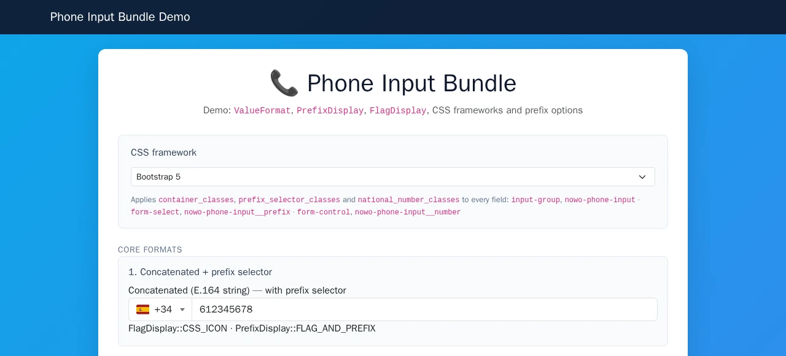
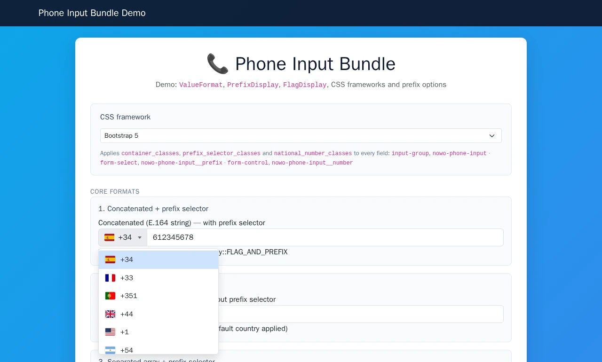

# Usage

## Table of contents

- [Screenshots](#screenshots)
- [Basic field](#basic-field)
- [Value formats](#value-formats)
- [Prefix selector options](#prefix-selector-options)
- [Overriding bundle templates](#overriding-bundle-templates)
- [Translations](#translations)
- [CSP-safe prefix picker](#csp-safe-prefix-picker)
- [CSS frameworks](#css-frameworks)

## Screenshots

| Overview | Interaction |
|----------|-------------|
|  |  |

Regenerate with `make -C demo/symfony8 demo-screenshots` (REQ-DEMO-013).

## Basic field

```php
use Nowo\PhoneInputBundle\Form\Type\PhoneType;

$builder->add('mobile', PhoneType::class);
```

## Value formats

```php
use Nowo\PhoneInputBundle\Form\ValueFormat;

// E.164 string (default): '+34612345678'
$builder->add('phone', PhoneType::class, ['value_format' => ValueFormat::CONCATENATED]);

// Array: ['iso' => 'ES', 'prefix' => '+34', 'national_number' => '612345678']
$builder->add('phone', PhoneType::class, ['value_format' => ValueFormat::SEPARATED]);

// PhoneNumber value object
$builder->add('phone', PhoneType::class, ['value_format' => ValueFormat::OBJECT]);
```

## Prefix selector options

```php
use Nowo\PhoneInputBundle\Form\PrefixDisplay;
use Nowo\PhoneInputBundle\Form\FlagDisplay;
use Nowo\PhoneInputBundle\Validation\PhoneValidationMode;

$builder->add('phone', PhoneType::class, [
    'country_prefix_selector' => true,
    'prefix_display' => PrefixDisplay::FLAG_AND_PREFIX,
    'show_flag' => true,
    'prefix_search' => true,
    'flag_display' => FlagDisplay::CSS_ICON,
    'allowed_countries' => ['ES', 'FR', 'GB'],
    'excluded_countries' => null,
    'phone_validation' => PhoneValidationMode::COUNTRY,
]);
```

## Overriding bundle templates

The bundle registers its views under the Twig namespace `NowoPhoneInputBundle` and appends its own path **after** the application paths, so files under **`templates/bundles/NowoPhoneInputBundle/`** always win (REQ-TWIG-001).

| `<subpath>` (under `src/Resources/views/`) | Purpose |
| ------------------------------------------ | ------- |
| `Form/phone_input_widget.html.twig` | Form theme block of `PhoneType` (`<nowo-phone-input>` host, prefix picker, national number). |
| `Form/_phone_country_flag.html.twig` | Flag partial used by the widget and the prefix list (CSS icon / emoji / none). |

Procedure:

1. Copy the vendor file to `templates/bundles/NowoPhoneInputBundle/<subpath>` in your application (same relative path and filename), e.g. `templates/bundles/NowoPhoneInputBundle/Form/_phone_country_flag.html.twig`.
2. Clear the cache in dev if needed: `php bin/console cache:clear`.
3. Treat the copy as a fork: Symfony resolves `@NowoPhoneInputBundle/Form/...` to your file from now on.

**Override vs upgrade (freeze rule).** An application file at the override path always wins and will not pick up vendor changes for that path until removed or merged. A full-file override is an escape hatch: that `<subpath>` stays frozen on every `composer update` while the rest of the bundle keeps upgrading.

Prefer the upgrade-safe path: the field options (`container_classes`, `prefix_selector_classes`, `national_number_classes`, `flag_display`, `show_flag`, …), the [translations](#translations) and CSS on the bundle classes cover most needs without a Twig fork. If you must override, copy only the small `_phone_country_flag.html.twig` partial rather than the whole widget.

**Recovering upstream after a freeze:** delete (or rename aside) the application override, clear the cache (`php bin/console cache:clear`), and re-apply only the customisation you still need. Diff your copy against the new vendor file under `vendor/nowo-tech/phone-input-bundle/src/Resources/views/` before re-copying.

## Translations

The widget texts are messages of the `NowoPhoneInputBundle` domain (en, es, fr, de, it, pt, nl):
`phone_input.prefix_label`, `phone_input.search_placeholder`, `phone_input.no_countries`. Override them in
`translations/NowoPhoneInputBundle.<locale>.yaml`. The default violation messages are in the `validators` domain.

## CSP-safe prefix picker

The widget is `<nowo-phone-input>` (light DOM: country picker + national number). It loads an external vanilla IIFE (no Stimulus required):

```twig
<script src="{{ asset('js/nowo-phone-prefix-picker.js', 'nowo_phone_input') }}" defer></script>
```

That script defines the custom element and enhances `[data-controller="phone-prefix-picker"]` and `[data-nowo-phone-prefix-picker]`. Markup also includes Stimulus-style `data-action` attributes so hosts can register a Stimulus controller named `phone-prefix-picker` instead of the IIFE (omit the script in that case). Prefer one approach per page to avoid double-binding.

Under a nonce-based CSP, allow the script URL (or nonce on `<script src>`); do not expect inline scripts to run.

## CSS frameworks

Override CSS classes per field or globally via `container_classes`, `prefix_selector_classes` and `national_number_classes`. See the demo (`?framework=bootstrap5|tailwind2|foundation6|symfony-default`).
